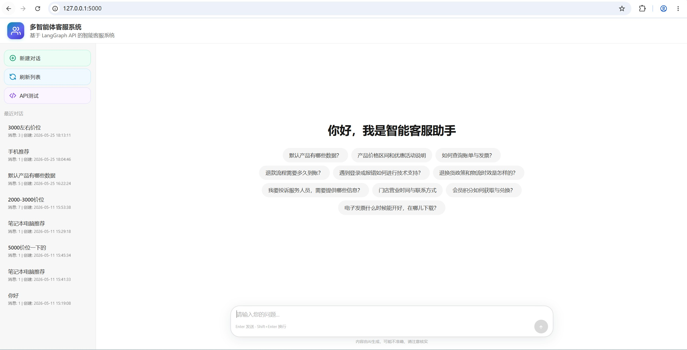
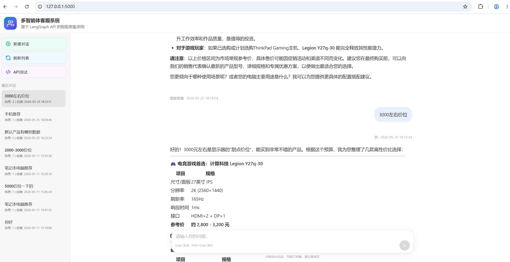
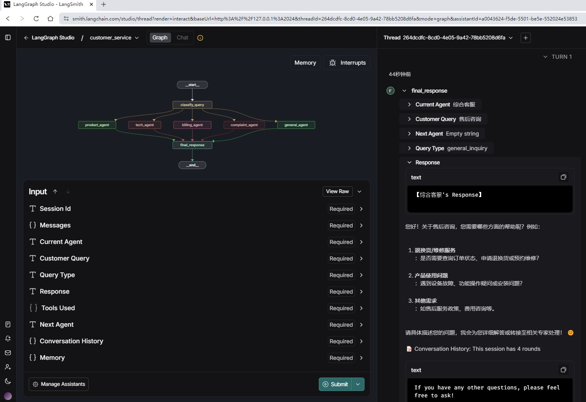

<h1 align="center">智能客服工作台</h1>

<p align="center">
  <a href="LICENSE"></a>
  <a href="https://www.python.org/"></a>
  <a href="https://github.com/langchain-ai/langgraph"></a>
  <a href="https://fastapi.tiangolo.com/"></a>
</p>

<p align="center"><em>意图分类 · 专家路由 · 受控转接 · RAG 检索增强 · 工具调用 · 会话持久化</em></p>

## 项目概述

基于 LangGraph 的多智能体客服系统。用户查询经意图分类后路由到五个领域专家（产品 / 技术支持 / 账单 / 投诉 / 综合），专家可检索本地知识库增强回答、调用业务工具，并按白名单规则单跳转接其他专家；对话状态由 SQLite checkpointer 持久化，跨请求可续聊。整个服务以 FastAPI 单进程运行，前端内置于同一服务，零额外部署组件。

## 运行效果

### 首页


### 多轮对话


### 工作流


## 核心设计

### 意图分类：三层防御
1. **结构化输出主路径**：`with_structured_output` 直接产出标签，脏输出概率最低；
2. **文本模式降级**：结构化解析失败时退回纯文本分类 + 解析；
3. **标签规范化兜底**：`normalize_classifier_label` 对未知标签做别名归一，仍失败则落入 `general_inquiry`，任何情况下路由不会悬空。

### 检索增强与工具调用
- **知识库检索**：`retrieval/` 自实现的 FAISS 封装（`IndexFlatIP` 余弦检索 + JSON 元数据），支持两种嵌入来源：OpenAI 兼容端点（`EMBEDDING_PROVIDER=api`）或本地 sentence-transformers 模型（`EMBEDDING_PROVIDER=local`，可指向本地模型目录）；索引未就绪时返回空串，Agent 自动降级为关键词匹配。
- **业务工具**：mock 订单查询、工单创建工具，经 `BaseAgent` 的有界工具循环执行（上限 3 轮），工具报错以文本回传给 LLM 自行解释，而非直接抛给用户。

### 受控转接（handoff）
专家间的协作不做全动态 supervisor——每轮多一次 LLM 调用在本场景是负收益。改为**白名单单跳转接**：目标必须在该专家的 `handoff_targets` 白名单内，`handoff_count` 上限 1 杜绝 A→B→A 循环，转接轮不写对话记录，最终回答由目标专家产出。

### 会话持久化
对话轮次写入 LangGraph checkpointer 状态（SQLite），以 `session_id` 为 thread_id 跨请求续聊；轻量会话注册表（`session_store.py`）负责会话列表、消息计数等元信息，两者职责分离。

## 项目结构

```
customer-service-ai-agent/
├── app.py                        # FastAPI 入口：图进程内运行 + SSE 流式接口
├── multi_agent_customer_service.py  # LangGraph 主图：分类 → 路由 → 转接 → 汇总
├── llm.py                        # ChatOpenAI 工厂（流式 / function calling / 无 Key 降级）
├── config.py                     # 配置（全部可由 .env 覆盖）
├── session_store.py              # 会话注册表（列表 / 计数 / 元信息）
├── multi_agents/                 # 五个领域专家，统一继承 BaseAgent
│   ├── base_agent.py             # 共享能力：上下文组装、检索、有界工具循环、转接
│   ├── product_agent.py / tech_agent.py / billing_agent.py
│   ├── complaint_agent.py / general_agent.py
├── tools/
│   ├── query_tools.py            # 意图分类工具与标签规范化
│   └── business.py               # mock 业务工具（查订单 / 建工单）
├── retrieval/
│   ├── vector_store.py           # FAISS 封装：构建与检索（api / local 双嵌入通道）
│   ├── build.py                  # 索引构建 CLI
│   └── kb_docs/                  # 知识库种子文档（产品 / 售后政策）
├── evaluation/
│   ├── golden_set.jsonl          # 30 条评测用例（6 类）
│   └── run_eval.py               # 评测脚本：分类正确率 / 拒答召回 / 延迟 P95
├── tests/                        # 31 条离线 pytest（不依赖 API Key）
├── templates/index.html          # 内置 Web 前端
├── Dockerfile / docker-compose.yml
└── env_example.txt               # 环境变量模板
```

## 快速开始

### 1. 安装依赖
```bash
pip install -r requirements.txt
```

### 2. 配置环境变量
```bash
cp env_example.txt .env   # Windows: copy env_example.txt .env
```
编辑 `.env` 填入 `OPENAI_API_KEY`（默认指向硅基流动，任何 OpenAI 兼容端点均可）。

### 3. 构建知识库索引（可选）
```bash
python -m retrieval.build
```
未构建索引时系统照常运行，回答退化为关键词匹配。使用本地嵌入时，先安装 `sentence-transformers` 并在 `.env` 设置 `EMBEDDING_PROVIDER=local` 与 `EMBEDDING_LOCAL_MODEL`。

### 4. 启动服务
```bash
python app.py
```
浏览器访问 `http://localhost:5000`。未配置 Key 时服务照常启动，回答走降级分支，便于离线调试界面与路由。

### Docker 一键启动
```bash
docker compose up --build
```
运行时产物（对话检查点、知识库索引、评测报告）通过 `./data` 卷落盘宿主机。容器内建索引：
```bash
docker compose exec app python -m retrieval.build
```

## API 一览

| 方法 | 路径 | 说明 |
|---|---|---|
| GET | `/` | Web 前端页面 |
| GET | `/api/health` | 健康检查 |
| GET | `/api/test` | 环境自检（图编译 / Key 配置 / checkpointer） |
| POST | `/api/chat` | 同步聊天 |
| POST | `/api/chat/stream` | SSE 流式聊天 |
| GET | `/api/sessions` | 会话列表 |
| GET | `/api/sessions/{id}` | 会话详情（含完整对话历史） |
| DELETE | `/api/sessions/{id}` | 删除会话（含 checkpointer 状态清理） |

## 评测

```bash
python -m evaluation.run_eval
```

30 条 golden 用例覆盖 6 个类别（产品 / 技术 / 账单 / 投诉 / 综合 / 越界拒答），产出 markdown 报告：分类别正确率、越界拒答召回率、延迟均值与 P95、失败用例明细；非零退出码可直接接入 CI。

## 测试

```bash
python -m pytest tests/ -q
```

31 条测试全部离线可跑（不依赖 API Key）：分类三层防御、图编译与护栏短路、转接路由与循环防护、工具调用循环（脚本化假 LLM 驱动）、检索降级、嵌入工厂双通道。

## 配置说明

| 环境变量 | 默认值 | 说明 |
|---|---|---|
| `OPENAI_API_KEY` / `OPENAI_BASE_URL` / `OPENAI_MODEL` | 硅基流动 + Qwen3-8B | LLM 端点 |
| `LLM_ENABLE_THINKING` | `false` | Qwen3 系列思考模式开关 |
| `EMBEDDING_PROVIDER` | `api` | `api`（OpenAI 兼容端点）或 `local`（sentence-transformers） |
| `EMBEDDING_MODEL` / `EMBEDDING_LOCAL_MODEL` / `EMBEDDING_DEVICE` | bge-large-zh-v1.5 | 嵌入模型与设备 |
| `RETRIEVAL_TOP_K` | `3` | 检索返回片段数 |
| `CHECKPOINT_DB_PATH` | `./data/checkpoints.sqlite` | 对话检查点 |
| `APP_HOST` / `APP_PORT` | `0.0.0.0:5000` | 服务监听 |

完整列表见 `env_example.txt`。

## 技术栈

LangGraph（工作流编排 + checkpointer）· LangChain Core（消息与结构化输出）· FAISS（本地向量检索）· FastAPI（单服务 + SSE）· pytest（离线回归）

## License

Apache 2.0
